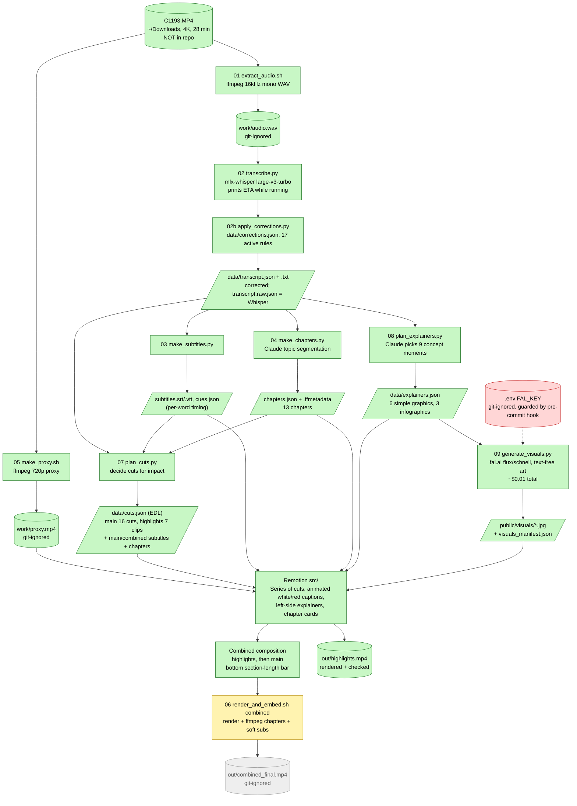

# Delivery Pilot Interview - AI video processing (C1193.MP4)

AI-based flow that transcribes an English interview video, builds subtitles and chapter markers, decides the cuts, and edits it with Remotion (animated white/red captions).

**This repo holds code, metadata and docs only.** The raw video (`~/Downloads/C1193.MP4`, 20.9 GB) and every generated video/audio file (`work/`, `out/`, `public/*.mp4`) are git-ignored and never committed.

Docs: [workflow: prompts and stages](docs/WORKFLOW.md) | [plan](docs/PLAN.md) | [rationale for every step](docs/DECISIONS.md) | [readable transcript](data/transcript.txt)

## Flow

Green = done, yellow = built but not yet run in full, grey = not run.



## Secrets
API keys live only in `.env` (git-ignored; copy `.env.example`). `.githooks/pre-commit` blocks any commit containing something that looks like a key. Enable it once per clone: `git config core.hooksPath .githooks`.

## Speakers
Marianna asks the questions; Rifat Erdem Sahin answers ([data/speakers.json](data/speakers.json)).

## Setup
```bash
python3 -m venv .venv && .venv/bin/pip install -r requirements.txt
npm install
```
Needs `ffmpeg`/`ffprobe` (Homebrew) and an Apple Silicon Mac for mlx-whisper. Source path defaults to `~/Downloads/C1193.MP4` (override with `SOURCE_VIDEO=...`).

## Steps (run in order)
| # | Command | Output | Time |
|---|---------|--------|------|
| 1 | `scripts/01_extract_audio.sh` | `work/audio.wav` | 2 s |
| 2 | `.venv/bin/python -I scripts/02_transcribe.py` | `data/transcript.raw.json` | ~1-2 min, shows ETA |
| 2b | `.venv/bin/python -I scripts/02b_apply_corrections.py` | `data/transcript.json`, `.txt` (corrected) | instant, prints hits per rule |
| 3 | `.venv/bin/python -I scripts/03_make_subtitles.py` | SRT, VTT, captions/cues JSON | instant |
| 4 | `.venv/bin/python -I scripts/04_make_chapters.py` | chapters JSON, ffmetadata, YouTube list | instant |
| 5 | `scripts/05_make_proxy.sh` | `work/proxy.mp4`, `public/proxy.mp4` hard link | ~10 min |
| 6 | `.venv/bin/python -I scripts/07_plan_cuts.py` | `data/cuts.json` + remapped subtitles/chapters | instant |
| 6b | (same script) | `subtitles.combined.srt`, `chapters.combined.*` | |
| 6c | `.venv/bin/python -I scripts/08_plan_explainers.py` | `data/explainers.json` | instant |
| 6d | `.venv/bin/python -I scripts/09_generate_visuals.py` | `public/visuals/*.jpg`, `data/visuals_manifest.json` | ~10 s, ~$0.01 (needs `.env`) |
| 7 | `npm run studio` (then open http://localhost:3000 in Chrome) | live preview of `Main`, `Highlights` and `Combined` (highlights first, then the full interview, with a section-length bar) | |
| 8 | `scripts/06_render_and_embed.sh highlights` | `out/highlights.mp4` | ~35 s |
| 9 | `scripts/06_render_and_embed.sh main` | `out/final.mp4` with chapters + soft subs | ~20-30 min |
| 10 | `scripts/06_render_and_embed.sh combined` | `out/combined_final.mp4` (highlights first, explainers, section bar) | ~20-30 min |

## How the cuts are decided
See the docstring in [`scripts/07_plan_cuts.py`](scripts/07_plan_cuts.py). In short: drop pre/post-roll, shorten pauses over 0.8 s, cut filler words (main edit); hook-first, claim-by-claim highlights picked by Claude and located by exact phrase (highlights reel). Remotion plays `data/cuts.json` back-to-back, so changing the edit means editing the script and re-running step 6, not touching video.
