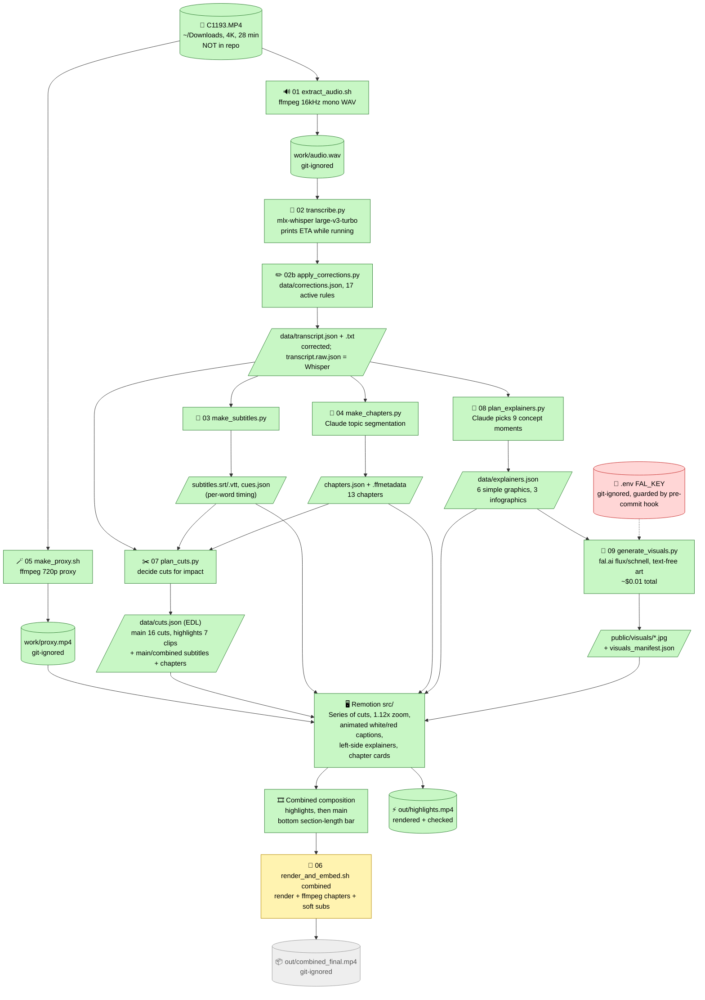

# 🎬 Delivery Pilot Interview: AI video processing (C1193.MP4)

▶️ **Watch the video:** https://youtu.be/VOtlOfpXVU8 · 💼 **LinkedIn post:** https://lnkd.in/p/e5GMfT5V · ✖️ **X post:** https://x.com/rifaterdemsahin/status/2119868364722208900

🌐 **Live site:** https://rifaterdemsahin.github.io/2026-W46_Delivery_Pilot_Interview/ (▶️ YouTube · 💼 LinkedIn · ✖️ X copy-and-publish pages, 💸 costs)

🤖 An AI-based flow that **transcribes** an English interview, builds **subtitles** and **chapter markers**, decides the **cuts**, adds **animated explainer visuals**, and edits everything in **Remotion** with animated white/red captions.

> 🚫 **This repo holds code, metadata and docs only.** The raw video (`~/Downloads/C1193.MP4`, 20.9 GB) and every generated video/audio file (`work/`, `out/`, `public/*.mp4`) are git-ignored and never committed.

📚 **Docs:** [✅ checklist](docs/CHECKLIST.md) · [🎬 production workflow](docs/VIDEO_PRODUCTION.md) · [🕒 timeline](docs/TIMELINE.md) · [🏷️ changelog](CHANGELOG.md) · [🤖 CLAUDE.md](CLAUDE.md) · [🧭 workflow: prompts and stages](docs/WORKFLOW.md) · [🗺️ plan](docs/PLAN.md) · [🧠 rationale for every step](docs/DECISIONS.md) · [📝 readable transcript](data/transcript.txt)

## 👥 Speakers
🎙️ **Marianna** asks the questions · 🧑‍💻 **Rifat Erdem Sahin** answers ([data/speakers.json](data/speakers.json)).

## 📊 Status

| | Stage | State |
|---|-------|-------|
| 🔊 | Audio extraction | ✅ done |
| 📝 | Transcription (Whisper, word timing, ETA shown) | ✅ done |
| ✏️ | Transcript corrections (17 rules, raw kept) | ✅ done |
| 💬 | Subtitles (SRT, VTT, per-word cues) | ✅ done |
| 📖 | Chapters (13, AI-segmented) | ✅ done |
| ✂️ | Cut planning (main 16 cuts, highlights 7 clips) | ✅ done |
| 🎨 | Explainers (6 animated graphics, 3 fal.ai infographics) | ✅ done |
| 🖥️ | Remotion edit (captions, cards, section bar, zoom) | ✅ done |
| 🎞️ | Highlights reel render | ✅ rendered and checked |
| 🖼️ | Thumbnail, title, description ([docs/PUBLISH.md](docs/PUBLISH.md)) | ✅ done |
| 🚀 | Full `Combined` render | ✅ exported (25:49, 720p, `out/combined_final.mp4`) |
| 💼 | LinkedIn cut (12:36, under the 14:00 limit) | ✅ rendered (`out/linkedin_final.mp4`) |
| 🖼️ | Three A/B/C thumbnails | ✅ done (`assets/thumbnails/test1_*`) |
| ✅ | Checklist and 🎬 video production workflow pages | ✅ on the site, mirrored in `docs/CHECKLIST.md` and `docs/VIDEO_PRODUCTION.md` |
| 🌐 | GitHub Pages site (overview, YouTube, LinkedIn, X, costs) | ✅ deployed |
| 🔊 | Sound effects and music (fal.ai, 8 clips) | ✅ generated and mixed in |
| 𝕏 | X version (1:22, under X's 2:20 limit) | ✅ rendered (`out/x_final.mp4`) |

## 🔀 Flow

🟩 done · 🟨 built, not run in full · 🟥 secret · ⬜ not run



## 🎞️ Remotion compositions

| Composition | What it is | Length |
|-------------|-----------|--------|
| ⚡ `Highlights` | 7 hook-first, quotable clips | 52.8 s |
| 🎬 `Main` | Full interview, tightened (pre/post-roll and long pauses cut) | 1658.3 s |
| 🎞️ `Combined` | Highlights first, then Main, with a bottom bar showing how long each section is | 1711.1 s |

✨ **What is on screen**
- 💬 Animated captions: white words, the spoken word turns **red** and pops
- 🧩 Left-side explainers: simple animated graphics, or an infographic for complex ideas
- 🏷️ Chapter title cards, plus a section-length bar (`Combined`) or progress bar (`Main`)
- 🔍 Slight 1.12x zoom anchored on the speaker (`ZOOM` in `src/config.ts`)

## 🧩 Explainers: simple vs complex

| Moment | Type | How it is made |
|--------|------|----------------|
| 🔁 CI to CD | simple flow | Remotion animation |
| 🤖 Bots build bots (300) | simple counter and grid | Remotion animation |
| 🕸️ Agent to agent | simple network | Remotion animation |
| 🛒 Tesco, Sainsbury's, Maria's door | simple flow | Remotion animation |
| 📉 20-30% desk-based jobs | simple stat | Remotion animation |
| 📣 Workshops | simple card | Remotion animation |
| 🐎🚗✈️ Rider, Driver, Pilot | **infographic** | fal.ai art + Remotion labels |
| 🧍📦🤖 Agent vs Bot vs Robot | **infographic** | fal.ai art + Remotion labels |
| 🛩️ What a pilot needs | **infographic** | fal.ai art + Remotion labels |

💸 Images use `fal-ai/flux/schnell`, a cheap 4-step model (about $0.01 for everything). The art is text-free and **labels are drawn by Remotion**, because image models garble text.

## 🏷️ Versions
Every deliverable is versioned: current **v0.12.0** (see [CHANGELOG](CHANGELOG.md)). Each version has a git tag and a snapshot in `versions/v*/`; earlier thumbnails are kept in `assets/thumbnails/`. New version: `scripts/version.py bump minor "notes"`.

## 🔐 Secrets
🗝️ API keys live only in `.env` (git-ignored; copy `.env.example`). 🛡️ `.githooks/pre-commit` blocks any commit containing something that looks like a key. Enable it once per clone:
```bash
git config core.hooksPath .githooks
```

## 🛠️ Setup
```bash
python3 -m venv .venv && .venv/bin/pip install -r requirements.txt
npm install
cp .env.example .env   # then add your FAL_KEY (never commit it)
```
Needs `ffmpeg`/`ffprobe` (Homebrew) and an Apple Silicon Mac for mlx-whisper. 📁 Source path defaults to `~/Downloads/C1193.MP4` (override with `SOURCE_VIDEO=...`).

## 🪜 Steps (run in order)

| # | | Command | Output | Time |
|---|---|---------|--------|------|
| 1 | 🔊 | `scripts/01_extract_audio.sh` | `work/audio.wav` | 2 s |
| 2 | 📝 | `.venv/bin/python -I scripts/02_transcribe.py` | `data/transcript.raw.json` | ~1-2 min, shows ETA ⏱️ |
| 2b | ✏️ | `.venv/bin/python -I scripts/02b_apply_corrections.py` | `data/transcript.json`, `.txt` (corrected) | instant, prints hits per rule |
| 3 | 💬 | `.venv/bin/python -I scripts/03_make_subtitles.py` | SRT, VTT, captions/cues JSON | instant |
| 4 | 📖 | `.venv/bin/python -I scripts/04_make_chapters.py` | chapters JSON, ffmetadata, YouTube list | instant |
| 5 | 🪄 | `scripts/05_make_proxy.sh` | `work/proxy.mp4`, `public/proxy.mp4` hard link | ~10 min |
| 6 | ✂️ | `.venv/bin/python -I scripts/07_plan_cuts.py` | `data/cuts.json` + main/combined subtitles and chapters | instant |
| 6c | 🧩 | `.venv/bin/python -I scripts/08_plan_explainers.py` | `data/explainers.json` | instant |
| 6d | 🎨 | `.venv/bin/python -I scripts/09_generate_visuals.py` | `public/visuals/*.jpg`, `data/visuals_manifest.json` | ~10 s, ~$0.01 (needs `.env`) |
| 7 | 👀 | `npm run studio` then open http://localhost:3000 in Chrome | live preview of `Main`, `Highlights`, `Combined` | |
| 8 | ⚡ | `scripts/06_render_and_embed.sh highlights` | `out/highlights.mp4` | ~35 s |
| 9 | 🎬 | `scripts/06_render_and_embed.sh main` | `out/final.mp4` with chapters + soft subs | ~20-30 min |
| 10 | 🎞️ | `scripts/06_render_and_embed.sh combined` | `out/combined_final.mp4` | ~15 min |
| 10b | 💼 | `scripts/06_render_and_embed.sh linkedin` | `out/linkedin_final.mp4` (12:36) | ~7 min |
| 10c | 𝕏 | `scripts/06_render_and_embed.sh x` | `out/x_final.mp4` (1:22) | ~1 min |
| 9 | 🔊 | `.venv/bin/python -I scripts/14_generate_audio.py` | `public/audio/*.mp3`, `data/audio_manifest.json` | ~1 min, ~$0.13 (needs `.env`) |
| 11 | 🖼️ | `scripts/10_make_thumbnail.sh` | three thumbnails A/B/C in `assets/thumbnails/` (+ `assets/thumbnail.jpg` = A) | ~30 s |
| 13 | 🌐 | `.venv/bin/python -I scripts/13_build_site.py` then push | `site/` (deployed to GitHub Pages by the workflow) | instant |
| 12 | 📣 | `.venv/bin/python -I scripts/11_make_publish.py` | `docs/PUBLISH.md`, `data/description.txt` (title, description, chapters, tags) | instant |

## 🗂️ Repo map
```
README.md          you are here
site/              GitHub Pages site (generated by scripts/13_build_site.py, deployed by .github/workflows/static.yml)
CLAUDE.md          project rules for Claude Code (read first)
CHANGELOG.md       every version, and VERSION / versions/v*/ snapshots
docs/              PLAN, DECISIONS (rationale per step), WORKFLOW (prompts and stages)
scripts/           01-09 pipeline scripts (+ 02b corrections, 06 render)
data/              transcript, subtitles, chapters, cuts (EDL), explainers, corrections, speakers
src/               Remotion: Main, Subtitles, Explainer, ChapterCard, SectionBar, ProgressBar, edit
public/visuals/    fal.ai infographic art (small JPGs)
.githooks/         pre-commit secret guard
work/  out/  .env  git-ignored: media, renders, secrets
```

## ✂️ How the cuts are decided
See the docstring in [`scripts/07_plan_cuts.py`](scripts/07_plan_cuts.py).
- 🎬 **Main edit:** drop pre/post-roll, shorten pauses over 0.8 s, cut filler words.
- ⚡ **Highlights:** hook-first, claim-by-claim picks by Claude, located by exact phrase.
- 🧾 Remotion plays `data/cuts.json` back-to-back, so changing the edit means editing the script and re-running step 6, not touching video.

## 🔄 Keeping this README current
The flow diagram and status table are updated at every step, together with a commit and push. 🧠 Rationale for each decision goes in [docs/DECISIONS.md](docs/DECISIONS.md).
