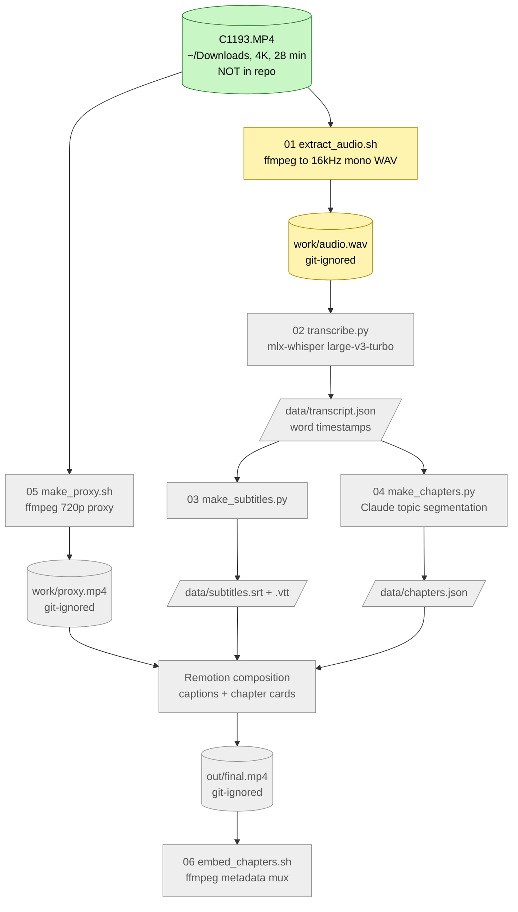

# Delivery Pilot Interview - AI video processing (C1193.MP4)

AI-based flow that transcribes an English interview video, builds subtitles and chapter markers, and edits it with Remotion.
**This repo holds metadata and code only. Video and audio files are git-ignored.**
Plan: [docs/PLAN.md](docs/PLAN.md) | Rationale log: [docs/DECISIONS.md](docs/DECISIONS.md)

## Flow

Legend: done = green, pending = grey.



## Setup
```bash
python3 -m venv .venv && .venv/bin/pip install -r requirements.txt
npm install
```

## Run
```bash
scripts/01_extract_audio.sh
```
