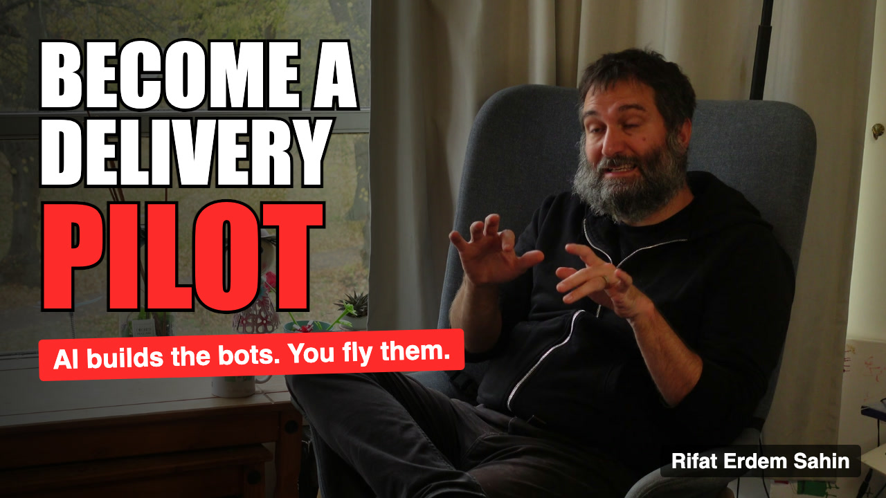

# Publishing copy

Generated by `scripts/11_make_publish.py` (edit the text there, re-run). Chapter times match the **Combined** render
(highlights first, 52.8 s). If you upload the Main-only render, use `data/chapters.main.json` times instead.

## Thumbnail
`assets/thumbnail.jpg` (1280x720, about 160 KB, under YouTube's 2 MB limit). Curiosity design: a specific number hook
("300 Bots / 1 Pilot", from the interview), an open question ("Who is flying yours?"), AI art of a lone pilot facing a wall of
bots (fal.ai `flux/schnell`, `scripts/12_generate_thumbnail_art.py`), and the real speaker on a framed card (4K frame, `scripts/10_make_thumbnail.sh`).
Text is drawn in Remotion (`src/Thumbnail.tsx`), never by the image model.



## Title (72 characters, YouTube limit is 100)
**Become a Delivery Pilot: Why AI Is Building AI (and What to Do About It)**

Alternatives:
- From Rider to Driver to Pilot: The AI Skills Shift Explained (60)
- AI Bots Are Building AI Bots: Why You Need to Become a Delivery Pilot (69)
- Stop Typing, Start Directing: Delivering with AI Bots | Rifat Erdem Sahin (73)

## Description (copy-paste)
```
AI is now building AI. So what is left for people to do? Rifat Erdem Sahin explains why we are moving from riders, to drivers, to pilots of AI bots, and what it takes to become a Delivery Pilot.

In this conversation with Marianna:
• Why "Delivery Pilot": continuous integration became possible with AI, continuous delivery is next
• Rider (web chat), Driver (Claude Code), Pilot (directing bots)
• What a bot is, and how it differs from an agent and a robot
• One bot writing 300 bots, digital twins and agent-to-agent communication
• Do we still need to learn coding? Why pilots need more training, not less
• Continuous learning, self-learners and the future of work
• The free Skool community and the Cambridge workshops

⏱ Chapters
0:00 Highlights
0:52 Introduction
1:22 Why a Delivery Pilot?
2:38 40 Years of Technology: From Atari to AI
3:57 From Rider to Driver to Pilot
5:14 The Three Levels of AI Skills
7:15 The Journey to Pilot Level
9:16 Chatbots, Agents and Bots Explained
13:35 Do We Still Need to Learn Coding?
16:10 Continuous Learning and Adult Education
17:23 Teaching, Gatekeepers and the Future of Work
20:51 Adapting the Mind and Self-Learning
22:45 Cambridge Workshops and the Skool Community
24:46 "AI Isn't for Me" and the Bigger Picture

🎙 Host: Marianna
🧑‍💻 Guest: Rifat Erdem Sahin

🔗 Join in
Skool community (free to join): https://www.skool.com/delivery-pilot-8938
Cambridge AI Academy, Build Your Own AI Agents (Eventbrite): https://www.eventbrite.co.uk/e/cambridge-ai-academy-build-your-own-ai-agents-tickets-2003566080080

If you lead teams, build products or wonder where your job goes next, tell us in the comments: are you a rider, a driver or a pilot today?

#AI #AIAgents #ClaudeCode #FutureOfWork
```

## Tags
delivery pilot, AI agents, AI bots, Claude Code, future of work, continuous delivery, continuous integration, rider driver pilot, digital twins, agent to agent, self learning, Cambridge AI, Skool community, AI skills, vibe coding

## Pinned comment
Rider, driver or pilot: where are you today, and what would you hand over to a bot first? 👇

## To fill in before publishing
- The YouTube URL, once the video is live (used in the LinkedIn and X posts as `[LINK]`)
- Confirm the spelling of names and products against the audio (see `data/corrections.json`)
