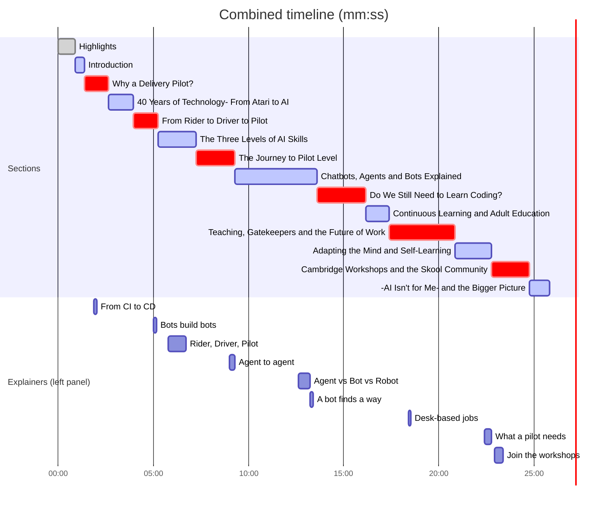

# Timeline

Regenerated by `scripts/07_plan_cuts.py` every time the cuts change. Times are on the **Combined** output (highlights first, then the full interview), total **25:49**.

## Overview

## Numbers

| | seconds |
|---|---|
| Source video | 1693.44 |
| Main edit | 1495.8 |
| Removed in total | 197.6 |
| of which duplicated ideas | 159.0 (8 cuts) |
| Highlights reel | 52.8 |
| Combined | 1548.6 |

## Duplicates removed (meaning kept)

| Source time | Length | Removed | Why | Idea kept at |
|---|---|---|---|---|
| 03:16-03:43 | 27 s | Right, it seems that today we don't need programmers as much as we nee ... lication. Isn't it amazing? Isn't it that crazy program that happened? | Host restates the guest's point (no need for programmers, build apps without coding) | 2:44-3:15 guest says it first |
| 04:59-05:18 | 19 s | What we need to become is, become pilots rather than drivers and make  ... d the direction is correct. So the bots are doing their jobs properly. | Repeats 'become pilots rather than drivers' and the Cambridge-bots aside; host then says the bots tangent was too fast | 5:56-6:50 explains rider/driver/pilot in full |
| 05:50-05:52 | 2 s | Let's talk about AI skills first. | Host asks to 'talk about AI skills' twice in 30 seconds | 5:22 first ask |
| 07:20-08:18 | 57 s | If we never use AI, we need to first become a writer. Then we need to  ...  are gonna go riding driving technology is the old way of doing things | Recap of rider/driver/pilot and 'AI builds the AI', already explained twice | 5:56-7:13 levels; 4:38-5:00 bots build bots |
| 14:36-14:39 | 4 s | So the bot is more probabilistic to be able to complete the goal. | Repeats 'bots are probabilistic' within seconds of saying it | 9:16-9:35 and 14:19 first statements |
| 15:30-15:51 | 21 s | What is happening right now is because the language gets abstracted, p ...  screen using a keyboard will be something of the past. But that means | Says again that people become pilots and stop using keyboards | 6:44-7:13 stop typing, start directing |
| 17:04-17:25 | 21 s | A pilot versus a driver. A pilot has more places to go than a car driv ... the plane the plane has more engineering in it to answer your question | Third telling of the horse/car/plane ladder, plus a stuttered repeat of 'to answer your question' | 5:56-6:50 levels |
| 22:43-22:51 | 8 s | a plane versus a car you You need to become much, much, much more creative and do meaningful stuff. | Repeats plane-versus-car and 'become more creative' | 24:35-25:01 what a pilot needs (creative, builder...) |

## Sections

| Output time | Section | Length |
|---|---|---|
| 00:00 | Highlights | 00:53 |
| 00:53 | Introduction | 00:30 |
| 01:22 | Why a Delivery Pilot? | 01:16 |
| 02:38 | 40 Years of Technology: From Atari to AI | 01:20 |
| 03:58 | From Rider to Driver to Pilot | 01:16 |
| 05:14 | The Three Levels of AI Skills | 02:01 |
| 07:16 | The Journey to Pilot Level | 02:01 |
| 09:16 | Chatbots, Agents and Bots Explained | 04:19 |
| 13:36 | Do We Still Need to Learn Coding? | 02:35 |
| 16:11 | Continuous Learning and Adult Education | 01:13 |
| 17:24 | Teaching, Gatekeepers and the Future of Work | 03:28 |
| 20:52 | Adapting the Mind and Self-Learning | 01:54 |
| 22:46 | Cambridge Workshops and the Skool Community | 02:00 |
| 24:46 | "AI Isn't for Me" and the Bigger Picture | 01:02 |

## Explainers

| Output time | Kind | Title | Length |
|---|---|---|---|
| 01:52 | flow | From CI to CD | 10 s |
| 05:01 | tree | Bots build bots | 10 s |
| 05:48 | infographic | Rider, Driver, Pilot | 54 s |
| 09:01 | network | Agent to agent | 16 s |
| 12:38 | infographic | Agent vs Bot vs Robot | 36 s |
| 13:14 | flow | A bot finds a way | 10 s |
| 18:25 | stat | Desk-based jobs | 6 s |
| 22:23 | infographic | What a pilot needs | 23 s |
| 22:55 | card | Join the workshops | 29 s |

## Highlights reel (first 52.8 s)

| Output time | Source time | Why it is in |
|---|---|---|
| 00:00 | 03:59-04:06 | Hook: the boldest claim, opens the reel |
| 00:06 | 04:46-04:56 | Concrete proof of scale, makes the hook credible |
| 00:16 | 04:59-05:05 | The core metaphor in one line |
| 00:22 | 06:44-06:51 | Vivid change in how people work |
| 00:29 | 14:46-14:52 | What a bot is, in plain words |
| 00:35 | 17:55-18:02 | Honest risk beat, adds credibility |
| 00:42 | 24:21-24:32 | Closing payoff: the human role |

## Kept footage (main edit)

21 intervals; everything not listed was cut (pre-roll, long pauses, duplicates).

| Output time | Source time | Length |
|---|---|---|
| 00:53 | 00:10-03:15 | 185 s |
| 03:58 | 03:43-04:59 | 76 s |
| 05:14 | 05:18-05:48 | 30 s |
| 05:44 | 05:52-07:20 | 88 s |
| 07:12 | 08:18-10:22 | 124 s |
| 09:16 | 10:23-10:27 | 4 s |
| 09:20 | 10:28-10:35 | 7 s |
| 09:28 | 10:36-10:47 | 11 s |
| 09:39 | 10:48-12:21 | 93 s |
| 11:12 | 12:21-14:36 | 134 s |
| 13:26 | 14:40-14:52 | 13 s |
| 13:38 | 14:54-15:30 | 36 s |
| 14:15 | 15:51-16:38 | 48 s |
| 15:03 | 16:39-17:04 | 25 s |
| 15:28 | 17:30-17:49 | 19 s |
| 15:47 | 17:50-22:43 | 293 s |
| 20:40 | 22:51-23:03 | 11 s |
| 20:51 | 23:04-24:58 | 114 s |
| 22:46 | 25:04-27:04 | 120 s |
| 24:46 | 27:05-27:11 | 6 s |
| 24:52 | 27:11-28:08 | 57 s |
